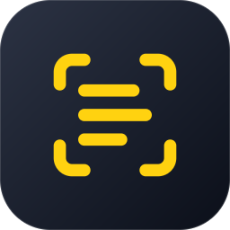
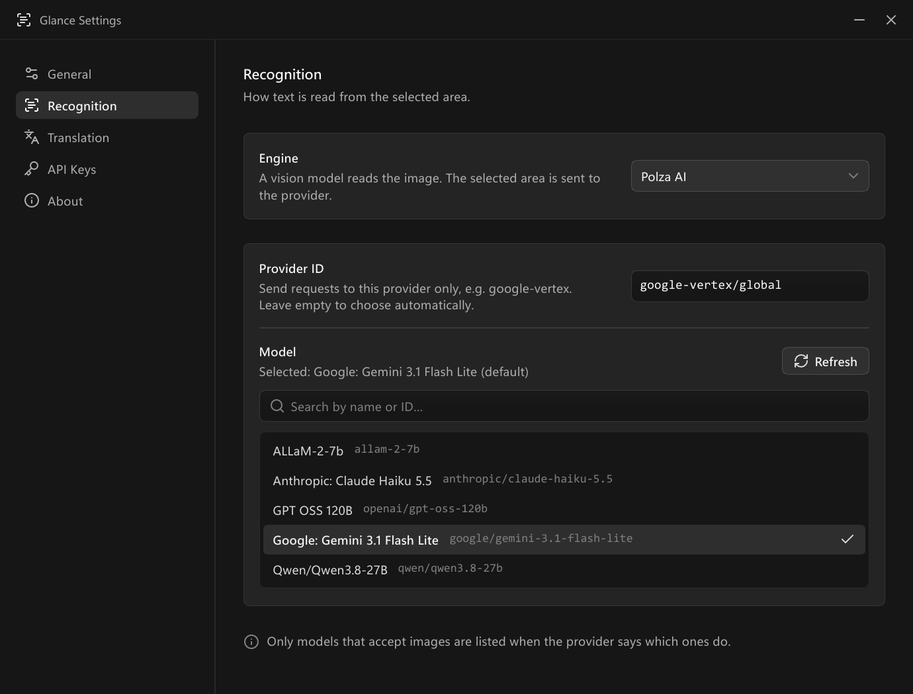

<p align="center">
  
</p>

<h1 align="center">Glance</h1>

<p align="center">
  Screen OCR and translation from the Windows system tray.<br>
  Press a shortcut, drag over any text on screen, then copy it or translate it.
</p>

<p align="center">
  
  
  
  
  <a href="https://github.com/neodym121/glance/actions/workflows/build.yml"></a>
  <a href="LICENSE"></a>
</p>

<p align="center">
  <b>English</b> · <a href="README.ru.md">Русский</a>
</p>

Glance is a native Rust app with a [Slint](https://slint.dev) UI: no WebView, Electron or
browser engine. Idle in the tray it uses about **2 MB of memory**.

## Features

- **Any text on screen**: images, videos, games, remote desktops, PDFs that block copying.
- **Recognition** with Paddle OCR (offline and free; the Slavic model reads Russian,
  Ukrainian and Belarusian, and there is an English one — both download once from
  Settings), or a vision model from Google Gemini, Mistral AI, Groq or Polza AI.
- **One-click translation** with an AI model, Google Translate (no key needed), DeepL or
  Microsoft Translator.
- **Model picker**: search by name or ID, refresh the list, or use any model ID.
- **Private**: keys live in Windows Credential Manager, screenshots never touch the disk.

## Download

Get it from [Releases](https://github.com/neodym121/glance/releases): the `.msi` installer
or the portable `.exe`. Needs 64-bit Windows 10 or 11.

## Using it

1. Press **Ctrl+Alt+S** (or click the tray icon) and drag over the text. **Esc** cancels.
2. The recognized text appears in a card and is copied to the clipboard.
3. **Translate** shows the translation, **Open** opens a link found in the text.

Settings open on the first launch, later from the tray menu.

<p align="center">
  
</p>

Paddle OCR downloads its model files (~12 MB per language) on first use, from
Settings → Recognition.

## API keys

One key per provider serves both recognition and translation. Paste it on the
**API Keys** page of the settings.

| Provider | Where to get a key |
|---|---|
| Google Gemini | [aistudio.google.com/apikey](https://aistudio.google.com/apikey) |
| Mistral AI | [console.mistral.ai/api-keys](https://console.mistral.ai/api-keys) |
| Groq | [console.groq.com/keys](https://console.groq.com/keys) |
| Polza AI | [polza.ai/dashboard/api-keys](https://polza.ai/dashboard/api-keys) |
| Google Translate (optional) | [Google Cloud console](https://console.cloud.google.com), Cloud Translation API |
| DeepL | [deepl.com/your-account/keys](https://www.deepl.com/your-account/keys) |
| Microsoft Translator | [Azure portal](https://portal.azure.com), a Translator resource |

## Building

Requires stable Rust with the MSVC toolchain and the Windows SDK.

```bash
cargo build --release
```

The installer is built by the [Build workflow](.github/workflows/build.yml) with WiX.

## License

[MIT](LICENSE). Icons: [Lucide](https://lucide.dev) (ISC license).

---

<p align="center">
  <a href="https://slint.dev"></a>
  <br>
  <sub>Glance is built with Slint. It works on your machine.</sub>
</p>
